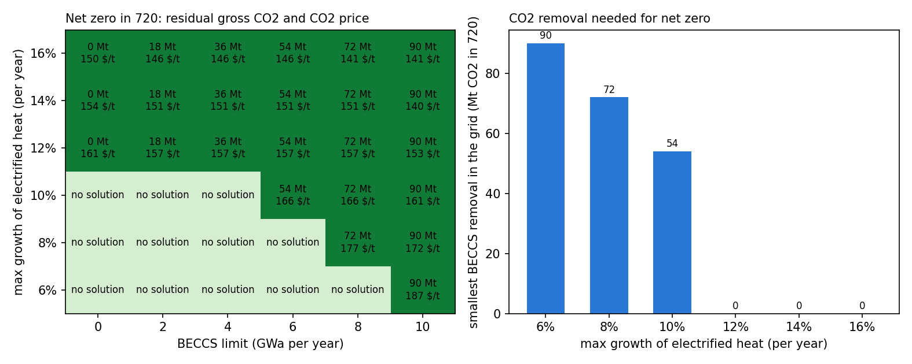
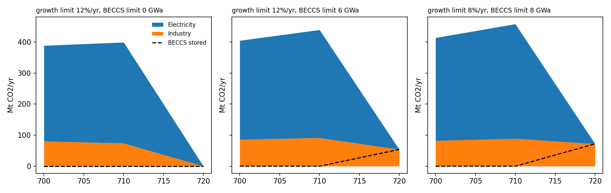

# Residual emissions and carbon removal in MESSAGEix (Westeros)

How fast does a hard-to-abate sector have to decarbonise for a net-zero target to hold, and what happens to its residual emissions when carbon dioxide removal (CDR) is available? This project answers both questions on the Westeros teaching model of [MESSAGEix](https://docs.messageix.org/), IIASA's open-source integrated assessment framework, by treating two of the usual scenario guardrails, the scale-up rate of a technology and the amount of CDR, as explicit model parameters.

All numbers are illustrative: Westeros is a fictional country built for teaching. The point is the mechanism.

## Main findings

- **Scale-up rate and CDR substitute for each other.** With net zero CO2 in 720, electrified industrial heat that may grow at 12% per year or faster makes net zero feasible without any CDR. Slower electrification needs removal: in the grid (steps of 18 Mt) the smallest BECCS volume that makes net zero feasible is 54 Mt at 10% per year, 72 Mt at 8% and 90 Mt at 6%; with less there is no feasible solution.
- **Available CDR is used to keep emitting.** In every feasible run the model uses the full BECCS limit and keeps exactly that much CO2 from coal-fired industrial heat: residual gross emissions rise one-for-one with the removal on offer, because removal is cheaper than further electrification. With electrification allowed at 12% per year, raising the BECCS limit from 0 to 10 GWa lowers the system cost by 13% and raises the 720 residual from 0 to 90 Mt.
- **The CO2 price reflects how tight the guardrails are**: 140 to 160 USD/t when electrification may grow quickly, up to 187 USD/t at a 6% growth limit, where the target only holds with the largest BECCS volume.





Full grid: [`results/table.md`](results/table.md).

## Model

**Baseline** ([`scripts/baseline.py`](scripts/baseline.py)): the Westeros model of the official MESSAGEix tutorial (`westeros_baseline.ipynb`, message_ix 3.11): light demand served by bulbs, a grid with 90% efficiency, coal and wind power, periods 700 to 720.

**Extension** ([`scripts/residual_emissions.py`](scripts/residual_emissions.py)):

| Element | Representation |
|---|---|
| Industrial heat demand | 30, 38 and 45 GWa in 700, 710 and 720; in 690 served by coal boilers |
| Coal boilers (`coal_heat`) | 3.0 tCO2/kWa, cheap, existing capacity |
| Electrified heat (`elec_heat`) | heat pumps and e-boilers, 0.6 units of electricity per unit of heat; activity may start at 0.2 GWa and then grow by at most *g* per year (`growth_activity_up`, `initial_activity_up`) |
| BECCS power (`bio_ppl_ccs`) | biomass power with CO2 capture, -9.0 tCO2/kWa, activity limited by biomass supply (`bound_activity_up`) |
| Coal power | 7.4 tCO2/kWa (tutorial value) |
| Target | net zero CO2 in 720 (`bound_emission`) |

The grid crosses the growth limit *g* (6% to 16% per year) with the BECCS limit (0 to 10 GWa): 36 runs, 24 of them feasible.

## Scenario data in IAMC format

[`scripts/to_iamc.py`](scripts/to_iamc.py) writes all feasible runs as one IAMC-format table with [pyam](https://pyam-iamc.readthedocs.io/) ([`results/iamc/`](results/iamc/)): gross CO2 by sector, BECCS storage, net CO2, electricity by source, industrial heat by technology and the CO2 price, with energy converted from GWa/yr to EJ/yr. It then checks the export against independent sources rather than against the totals it built itself: required variables for every scenario, industrial heat equal to the demand given to the model, electricity after grid losses covering lighting and electrified heat, gross CO2 equal to the run summary, net zero in 720 and BECCS storage within each run's biomass limit. All checks pass: [`results/iamc/checks.md`](results/iamc/checks.md).

## How to run

Python 3.10+, a Java runtime (11 or newer, for the ixmp database) and GAMS (the free demo licence is enough for Westeros).

```bash
python -m venv .venv
.venv/Scripts/activate              # Windows; on Linux/macOS: source .venv/bin/activate
pip install -r requirements.txt
set JAVA_HOME=<path to Java>        # Linux/macOS: export JAVA_HOME=...
set GAMS_SYSDIR=<path to GAMS>      # or have `gams` on PATH
python scripts/baseline.py          # tutorial baseline
python scripts/residual_emissions.py   # 36 runs, about 2 minutes
python scripts/to_iamc.py           # IAMC export, checks, figure 2
```

Scenarios are stored in a local database in `db/` (not committed).

## Limitations

- One node, three periods and a single hard-to-abate sector; costs and emission factors are round illustrative values.
- BECCS is the only CDR option and biomass has no competing use or price, so the substitution between removal and residual emissions is starker than in a full model.
- The growth limit is a single annual rate; real scale-up constraints differ by period and depend on supply chains.

## References

- Huppmann, D. et al. (2019). The MESSAGEix Integrated Assessment Model and the ix modeling platform (ixmp). *Environmental Modelling & Software* 112, 143-156.
- Huppmann, D. et al. (2021). pyam: Analysis and visualisation of integrated assessment and macro-energy scenarios. *Open Research Europe* 1:74.
- MESSAGEix tutorials, Westeros series: https://docs.messageix.org/en/latest/tutorials.html (Apache License 2.0). The baseline in this repository follows `westeros_baseline.ipynb`.

Author: Mikhail Serikov, 2026.
